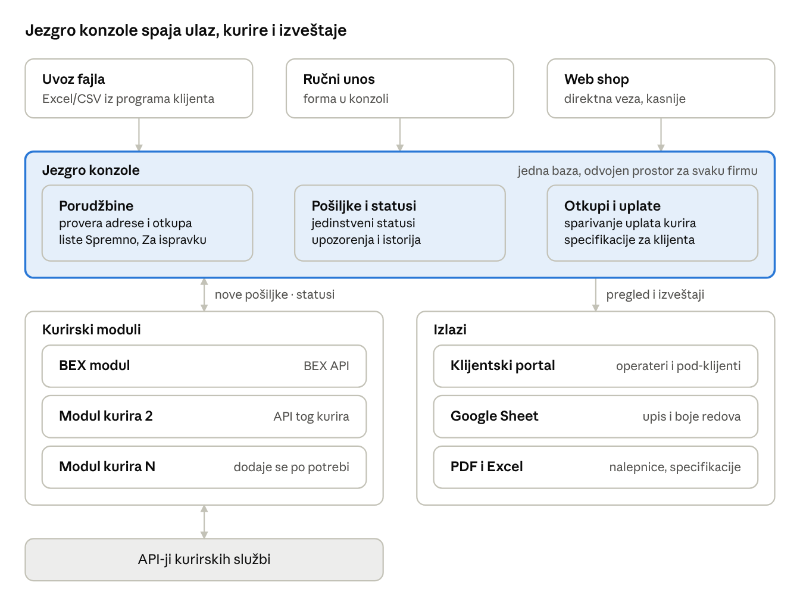
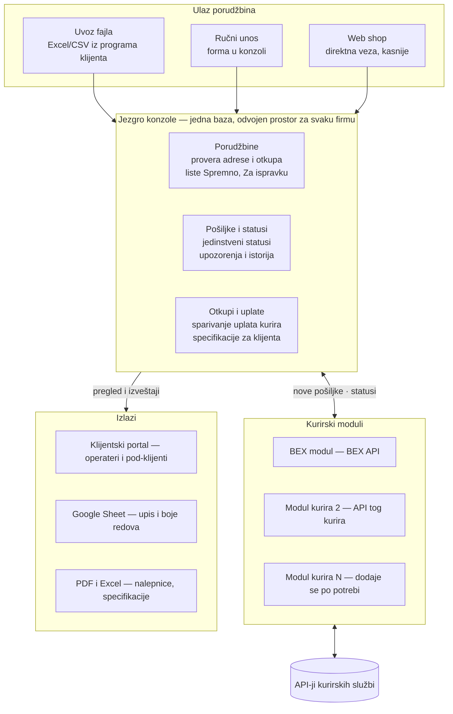

# Konzola za praćenje pošiljki — ideja i workflow

Nov 8, 2026 · @uros kralj

## Ideja

Konzola je jedno mesto gde firma koja šalje pakete vidi sve svoje porudžbine, pošiljke, statuse i otkupe, bez obzira na to kojom kurirskom službom šalje. Podatke ne unosi ručno: konzola ih povlači direktno sa kurirskih API-ja.

Konzola je zaseban brend. Nije vezana ni za jednu firmu-pošiljaoca ni za jednog kurira. Na nju se priključuje bilo koja firma (web shop, distributer, fulfillment centar), a kuriri se dodaju kao zasebni moduli.

Kome služi:

- **Web shopovima i malim distributerima** koji dnevno šalju desetine ili stotine paketa i danas statuse prate po portalima i tabelama.
- **Fulfillment i logističkim centrima** koji šalju u ime više klijenata i svakom treba da pokažu samo njegove pošiljke.
- **Krajnjem kupcu** (kasnije), kroz jednostavnu stranicu za praćenje pod brendom konzole.

Otvoreno pitanje: naziv brenda još nije izabran; u dokumentu se koristi radni naziv *Konzola*.

## Struktura

Konzola ima četiri sloja: ulaz porudžbina, jezgro sa bazom, kurirske module i izlaze prema klijentu.

Jezgro ne zna detalje nijednog kurira: sa kuririma razgovaraju samo moduli. Novi kurir zato znači jedan novi modul, a porudžbine, statusi i otkupi rade isto kao do tada.

## Workflow porudžbine

Porudžbina ulazi jednom, a konzola od nje sama pravi pošiljku kod izabranog kurira i vraća broj pošiljke i nalepnicu.

1. **Ulaz porudžbine.** Tri načina: uvoz fajla (Excel/CSV iz programa koji klijent već koristi), ručni unos u formi, ili kasnije direktna veza sa web shopom.
2. **Mapiranje kolona.** Pri prvom uvozu klijent jednom poveže svoje kolone sa poljima konzole (ime, adresa, telefon, otkup, težina, napomena). Konzola pamti mapu za svaki sledeći uvoz.
3. **Provera.** Konzola proverava adresu (mesto i ulicu kroz šifarnik kurira), telefon i iznos otkupa. Neispravni redovi idu u listu "Za ispravku", ostali u "Spremno".
4. **Izbor kurira.** Podrazumevani kurir po klijentu, uz mogućnost promene po porudžbini.
5. **Kreiranje pošiljki.** Jednim klikom sve spremne porudžbine šalju se kuriru u jednom paketu zahteva (batch). Kurir vraća broj pošiljke za svaku.
6. **Nalepnice.** Konzola preuzima nalepnice i pravi jedan PDF za štampu cele ture.
7. **Predaja.** Pošiljke dobijaju status "Kreirano" i od tog trenutka ih konzola sama prati.

Greška u bilo kom koraku ne zaustavlja ostale porudžbine: problematična ostaje u listi sa razlogom, ostale idu dalje.

## Workflow isporuke i statusa

Konzola sama proverava svaku aktivnu pošiljku kod kurira i prevodi njegov status u jedan zajednički status, isti za sve kurire. Klijent zato vidi jednu listu i jedne boje, bez obzira ko nosi paket.

**Kako radi praćenje:**

- Konzola u razmacima (npr. na svakih sat vremena) pita kurirski API za status svih pošiljki koje nisu završene.
- Završene pošiljke (isporučeno ili vraćeno pošiljaocu) više se ne proveravaju.
- Svaka promena se čuva sa vremenom, pa je za svaki paket vidljiva cela istorija.

**Jedinstveni statusi:**

| Status u konzoli | Šta znači | Primer kod BEX-a | Boja |
| --- | --- | --- | --- |
| Kreirano | Pošiljka prijavljena, kurir je još nije preuzeo | Evidentirano (1) | Siva |
| U transportu | Kurir je preuzeo paket | Preuzeto (11) | Plava |
| Neuspela dostava | Pokušaj nije uspeo, paket je još kod kurira | Preuzeto + razlog neuspeha | Žuta |
| Isporučeno | Primalac je preuzeo paket | Dostavljeno (21) | Zelena |
| Povrat u toku | Paket se vraća pošiljaocu | Vratiti pošiljaocu (25) | Narandžasta |
| Vraćeno | Paket je stigao nazad | Vraćena pošiljaocu (30) | Crvena |

Novi kurir se dodaje tako što se samo njegove šifre statusa povežu sa ovih šest. Ostatak konzole se ne menja.

**Upozorenja koja konzola pravi sama:**

- Druga neuspela dostava ili odbijanje — crveno označen primalac, poziv kupcu.
- Pošiljka bez promene statusa duže od zadatog broja dana — lista "Zaglavljeno".
- Paket kreiran, a kurir ga nije preuzeo do kraja dana — lista "Nije preuzeto".

## Otkupi i uplate

Svaki otkup ima svoj tok novca u tri koraka, i konzola za svaki zna gde je: kod kupca, kod kurira, ili isplaćen klijentu.

| Faza otkupa | Kako konzola zna | Boja |
| --- | --- | --- |
| Čeka naplatu | Pošiljka još nije isporučena | Bez boje |
| Naplaćeno, kod kurira | Status "Isporučeno", uplata od kurira još nije stigla | Siva |
| Kurir uplatio | Pošiljka se pojavila u izveštaju o uplatama kurira | Žuta |
| Isplaćeno klijentu | Operater je uključio otkup u specifikaciju i označio isplatu | Zelena |

**Dnevni rad sa uplatama:**

1. Klik na "Povuci uplate za dan" — konzola učitava izveštaj kurira o uplaćenim otkupima i sparuje ga sa pošiljkama po broju pošiljke.
2. Svi spareni otkupi prelaze u žuto, a nespareni idu u listu za proveru.
3. Operater bira šta šalje klijentu (sve, ili samo deo ako neka uplata kasni ili je sporna).
4. Konzola pravi specifikaciju uplate za klijenta (PDF ili Excel) i označava te otkupe zeleno.

Ograničenje: javni BEX API trenutno nema izveštaj o uplatama otkupa. Dok ga kurir ne ponudi, izveštaj se uvozi kao fajl preuzet sa kurirskog portala; korak 1 ostaje isti, samo je izvor fajl umesto API-ja.

## Uloge i pristup

Svaka firma-klijent ima svoj zatvoren prostor: vidi samo svoje porudžbine, pošiljke i otkupe, i koristi svoje API ključeve kod kurira.

| Uloga | Ko je to | Šta može |
| --- | --- | --- |
| Vlasnik platforme | Tim koji vodi brend konzole | Otvara i gasi firme, vidi sve, održava kurirske module, rezervne kopije |
| Administrator firme | Vlasnik ili šef u firmi-klijentu | Upravlja svojim zaposlenima, unosi API ključeve svojih kurira, odobrava isplate otkupa |
| Operater | Zaposleni u firmi-klijentu | Uvozi porudžbine, kreira pošiljke, štampa nalepnice, prati statuse |
| Pod-klijent (opciono) | Klijent fulfillment centra | Samo pregled svojih pošiljki i otkupa, bez izmena |

API ključevi kurira čuvaju se šifrovano, po firmi, i nikad se ne prikazuju u celosti nakon unosa.

## Šta klijent dobija

- **Jedan ekran umesto više portala i tabela.** Sve pošiljke svih kurira na jednom mestu, sa istim statusima i bojama.
- **Manje ručnog unosa.** Porudžbine se uvoze fajlom, pošiljke se kreiraju u turažama, nalepnice se štampaju odjednom.
- **Problemi se vide odmah.** Neuspele dostave, zaglavljene i nepreuzete pošiljke same se izdvajaju u liste.
- **Kontrola nad novcem.** Za svaki otkup se zna da li je naplaćen, uplaćen od kurira i isplaćen, a specifikacija se pravi jednim klikom.
- **Sloboda izbora kurira.** Firma može da promeni ili doda kurira bez promene načina rada.
